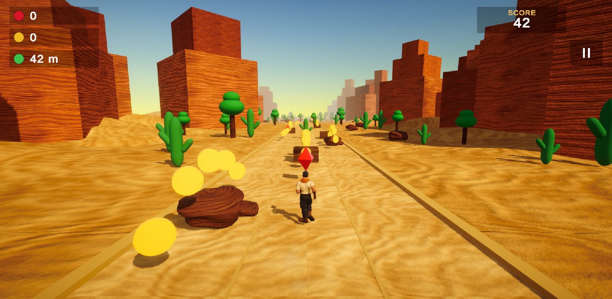

# Mirage Run 🎮

**Mirage Run** is a 3D endless runner game developed using Unity 6 and C#. The game takes place in a desert environment where players control a character running along an endless track. The main objective is to survive as long as possible by switching between lanes, jumping over obstacles, avoiding hazards, and collecting coins and gems along the way.

As the player progresses, the running speed gradually increases, making the game more challenging and exciting.

This project was developed as part of the Game Design and Development course at the School of Computer Science and Artificial Intelligence, SR University, during the academic year 2025–2026.



## Game Features

- **Three-lane movement:** Move between three lanes using simple keyboard controls.
- **Jumping:** Jump over rocks, crates, and other obstacles.
- **Endless environment:** New desert track sections are generated as the player moves forward, while older sections are removed.
- **Different track layouts:** Includes six manually designed track layouts with obstacles, coin arrangements, and gems.
- **Increasing difficulty:** The game starts at 11 m/s and gradually increases the speed up to 26 m/s.
- **Collectibles:** Collect coins and gems during the run.
- **Live game information:** Displays collected coins, gems, distance travelled, and score.
- **Game menus:** Includes a countdown before starting, pause menu, and Game Over screen with a new high-score notification.
- **Progress saving:** Uses Unity PlayerPrefs to save collected coins, gems, best distance, and highest score.
- **Multiple scenes:** Contains Main Menu, Stage Select, Information, and Gameplay scenes.
- **Audio:** Includes background music, desert wind ambience, sound effects, and a mute option.
- **Visual effects:** Uses Universal Render Pipeline (URP), custom desert environments, sand and rock materials, lighting effects, particles, and camera effects.
- **Scene transitions:** Smooth fade effects are used when moving between scenes.

## Controls

| Action | Keys |
|---|---|
| Move Left | A / Left Arrow |
| Move Right | D / Right Arrow |
| Jump | Space / W / Up Arrow |
| Pause | P / Esc |
| Mute Sound | M |

## Requirements

To open and run this project, you will need:

- Unity 6 (6000.5.8f1 or newer)
- Universal Render Pipeline (URP)
- TextMeshPro Essential Resources
- A system capable of running Unity 6

## Getting Started

Follow these steps to set up the project on your system.

1. Install Unity 6 using Unity Hub.
2. Create a new project using the **3D (URP)** template.
3. Copy the repository's `Assets` folder into your project's `Assets` directory.
4. If Unity asks for TextMeshPro resources, go to **Window → TextMeshPro → Import TMP Essential Resources**.
5. Check that a URP pipeline asset and renderer are assigned under **Edit → Project Settings → Graphics** and in the Quality settings.
6. From the Unity menu bar, select **Mirage Run → Build Everything**. This will automatically generate the required scenes, prefabs, materials, UI elements, and build settings.
7. If Unity reports that the input settings have changed, restart the editor and run the builder again.

   **Note:** The project uses Unity's legacy Input API. Set **Active Input Handling** to **Both** under Player Settings.

8. Once the setup is complete, open `Assets/Scenes/MainMenu` and press the Play button.

### Scene Build Order

Make sure the scenes are included in the following order:

1. MainMenu (0)
2. StageSelect (1)
3. Information (2)
4. GamePlay (3)

## Character and Running Animation

The default character model does not include a skeleton or rig. Because of this, the game uses a procedural running bounce animation as a fallback.

To use a proper running animation, follow these steps:

1. Visit [Mixamo](https://www.mixamo.com).
2. Choose a character and apply the **Running** animation.
3. Download the character in FBX Binary format with **With Skin** selected.
4. Save the downloaded file as:

   `Assets/Models/Character/Hero_Running.fbx`

5. Open Unity and run **Mirage Run → Build Everything** again.

If you already have a rigged character, you can save it as `Assets/Models/Character/Hero.fbx` and keep the animation file at `Assets/Animations/Running.fbx`.

If the character faces the wrong direction while running, use **Build Everything (turn hero 180 degrees)** from the Unity menu.

## Project Structure

The project is organised into different folders to keep the game files and resources easy to manage.

```text
Assets/
│
├── Animations/    Running animation and Animator controller
├── Audio/         Sound effects, wind and background music
├── Editor/        Scene and prefab generation tools
├── Materials/     URP materials and post-processing settings
├── Models/        Character and environment models
├── Prefabs/       Player and desert track prefabs
├── Scenes/        MainMenu, StageSelect, Information, GamePlay
├── Scripts/       Game mechanics and gameplay scripts
└── Textures/      Character and environment textures
```

## Scripts and Their Responsibilities

The game is divided into multiple C# scripts, with each script handling a particular part of the gameplay.

| Script | Description |
|---|---|
| `PlayerMovement` | Handles player movement, lane switching, jumping, and falling after death. |
| `GameManager` | Controls the game state, countdown, speed progression, pause, Game Over, and saved progress. |
| `SegmentGenerator` | Creates new track sections and removes previously used sections. |
| `Collectible` | Handles coin and gem collection, animations, and particle effects. |
| `Obstacle` | Detects collisions with obstacles and ends the current run. |
| `MasterLevelInfo` | Keeps track of coins, gems, distance, score, and HUD information. |
| `CameraFollow` | Follows the player and adds camera shake and field-of-view effects. |
| `AudioManager` | Manages background audio, sound effects, and mute settings. |
| `ScreenFader` | Handles fade transitions between scenes. |
| `MenuControl` | Manages menu buttons, saved progress, and game exit. |
| `AutoLoadScene` | Handles the loading screen and progress bar. |
| `PlayerDust`, `Fx` | Creates running dust and collectible particle effects. |
| `RunBob`, `Spin`, `MenuCameraSway` | Adds procedural movement and animations to game objects and menus. |

## Team Members

| Name | Roll Number |
|---|---|
| Add team member | Roll number |

**Project Guide:**  
Dr. Vijaya Chandra Jadala  
Assistant Professor  
School of Computer Science and Artificial Intelligence, SR University.

## Credits

- **Character and Running Animation:** [Mixamo](https://www.mixamo.com)
- **Audio:** Sound effects, background music, and desert ambience were generated for this project.
- **Environment:** Sand and rock textures, along with dune and rock meshes, were created procedurally for the game.
- **Game Engine:** Unity 6
- **Programming Language:** C#

## License

This project was developed for academic purposes as part of the Game Design and Development course at SR University.

A suitable open-source license, such as the MIT License, can be added if the project is intended to be shared or reused by others.
